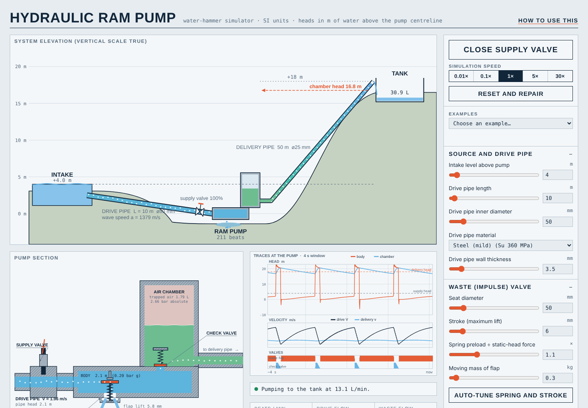
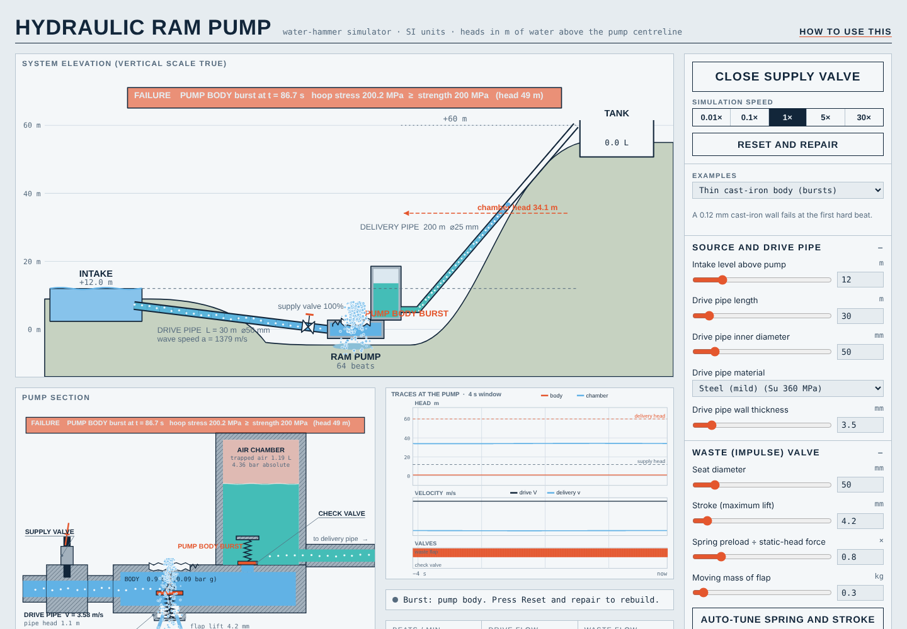

# Hydraulic Ram Pump Simulator

Live app: https://biswashk920.github.io/hydraulic-ram-pump/

Author: Biswash Kaphle

A browser simulator of a hydraulic ram pump. Water runs down a drive pipe from an intake, the waste valve slams shut, the water hammer pushes part of the water up a delivery pipe to a tank above the intake, and the rest is wasted. The app shows a sectional cutaway of the pump, an elevation view of the whole system and live pressure traces. Pipes, the pump body and the air chamber burst on screen when their walls cannot hold the pressure.



## Contents
- Quick start
- Features
- How to use
- Controls
- Bursting
- Physics and equations
- Tests
- Python notebook
- CSV files
- Project layout
- Limits and assumptions
- License

## Quick start
Run locally: open docs/index.html in Chrome, Edge or any Chromium browser. It is a single self-contained file, so no install or server is needed.

Press "Open supply valve". The pump starts beating after a few seconds.

## Features
- Sectional cutaway of the pump: supply valve, waste (impulse) valve flap and spring, check valve and air chamber, coloured by pressure head.
- System view from intake to delivery tank. Water rises in the delivery pipe at its computed speed.
- Scope showing body head, chamber head, drive-pipe flow and valve position.
- Every dimension is editable. There is no fixed lift cap; limits are wide and checked against the intake head.
- Material choice for the drive pipe, delivery pipe and pump body and chamber (8 materials). Hoop stress is checked every step. If it exceeds the material strength the part bursts, with a water jet, debris and a failure banner.
- Live water balance (drawn = wasted + stored + delivered + leaked), D'Aubuisson efficiency and design checks.
- 8 example designs (5 working, 3 that burst) and an Auto-tune button for the waste valve.
- CSV export of the design, the run log and the scope trace, and import of a design CSV.
- Light and dark themes, usable on a phone.
- A "How to use this" section at the bottom of the page.

## How to use
1. Pick an example from the preset list, or edit parameters in the side panel.
2. Press "Open supply valve". The speed buttons run the simulation faster.
3. Watch the cutaway. The flap opens, water accelerates in the drive pipe, the flap shuts, the pressure spike lifts the check valve, and some water enters the air chamber and climbs the delivery pipe.
4. Read the Strength check bars. A bar above 100 % means that part will burst.
5. If the pump does not beat, press "Auto-tune spring and stroke", or read the "If the pump stalls" notes on the page.
6. Press "Reset and repair" to restore a burst part.
7. Download the design and run data from the Export block.

## Controls
| Group | What it sets |
|---|---|
| Intake | supply head Hs (m) |
| Drive pipe | length, diameter, wall thickness, material |
| Waste valve | seat diameter, stroke, flap mass, spring ratio |
| Check valve and chamber | check valve diameter, chamber volume, chamber diameter and wall |
| Pump body | material, body wall thickness |
| Delivery pipe | diameter, length, wall, material, lift h, start empty or full |
| Simulation | valve opening time, burst on or off |

## Bursting
Hoop stress is sigma = rho * g * H * (D + t) / (2t), compared with the ultimate tensile strength of the selected material. It is checked for:
- the drive pipe, at every node along its length, so the break appears where the head is highest;
- the pump body (body head, body diameter taken as 2D);
- the air chamber;
- the delivery pipe.

On failure the part becomes a leak. The water leaving through the hole is counted in the water balance, and the pump usually stops. The presets "Thin PVC drive pipe", "Thin cast-iron body" and "Weak air chamber" burst on purpose. Untick "burst" to ignore failures.



Material data used (E = elastic modulus, Su = ultimate strength):

| Material | E (GPa) | Su (MPa) |
|---|---|---|
| Steel (mild) | 200 | 360 |
| Ductile iron | 170 | 420 |
| Grey cast iron | 100 | 200 |
| Copper | 117 | 220 |
| Bronze | 105 | 260 |
| Aluminium casting | 70 | 200 |
| PVC-U | 3 | 50 |
| HDPE (PE100) | 0.8 | 22 |

The exact values are in MATERIALS in src/physics.js.

## Physics and equations
All equations are implemented in src/physics.js and re-implemented independently in python/ram_pump_reference.ipynb.

1. Drive pipe, elastic water hammer
   Wave speed (Korteweg): a = sqrt(K/rho) / sqrt(1 + K*D/(E*e)), with K = 2.2 GPa, and E and e the wall modulus and thickness.
   The pipe is solved by the method of characteristics with N reaches and dt = L/(N*a):
   C+ : H_P = C_p - B*Q_P,  C- : H_P = C_m + B*Q_P,  B = a/(g*A).
   Friction is steady Darcy-Weisbach (Swamee-Jain for Re > 2000, 64/Re below), applied as R*Q*|Q|.

2. Pump body
   The body head Hb is found by bisection from continuity at the pump end: Q_pipe = Q_waste + Q_check + Q_rupture.
   - Supply valve: extra loss Kv = 0.2/phi^2, where phi is the valve opening, ramped over the valve time.
   - Waste valve: orifice with Cd = 0.65 and a stroke-dependent area.
   - Check valve: orifice with Cd = 0.7, open only when Hb is above the chamber head.
   - Rupture orifice: active only after the body has burst.

3. Waste valve (spring-loaded flap)
   Mass m, opening force vratio*rho*g*A*Hs (spring preload), closing force rho*g*Hb*A*(1 + 2.5*Aw/A) (pressure plus flow drag), damping 8 per second, hard stops at 0 and at the stroke. The closing-force model is empirical, which is why Auto-tune exists.

4. Air chamber
   Polytropic gas, p*V^1.2 = constant, minimum gas volume 0.2 % of the initial volume. Chamber head Hch = (p - Patm)/(rho*g).

5. Delivery pipe
   Rigid column, since the delivery line is slow compared with the drive pipe: dQ/dt = (g*A/L_f)*(Hch - h_f - losses), with a rising front position, Darcy friction and an exit loss. Water reaches the tank when the front reaches the pipe length.

6. Water balance
   drawn = wasted + body leak + drive leak + stored + delivered + chamber and delivery leaks.
   Body and delivery residuals are about 1e-16 m3. The drive-pipe residual (water compressed or stretched inside the pipe) is under 1e-4 of the intake.

7. Efficiency
   D'Aubuisson: eta = V_delivered * h / (V_drive * Hs). The tests check that energy out never exceeds energy in.

## Tests
```
npm test            # 17 physics tests (node:test, no dependencies)
npm i && npx playwright install chromium
npm run test:e2e    # 11 checks in headless Chromium
npm run build       # rebuilds docs/index.html from src/ (needed after editing src/)
```
The physics tests cover wave speed, hoop stress and burst head, Joukowsky surge, steady flow, water balance, energy, efficiency, every burst case, all material combinations and determinism. The browser test loads the page, runs the pump, checks the balance, exercises CSV export and import, the removed lift cap, all presets, reset, auto-tune, dark theme and phone width, and fails on any console error.

## Python notebook
python/ram_pump_reference.ipynb is an independent Python version of the model with plots: water balance, Joukowsky and steady-flow checks, hoop-stress chart per material, a lift design study, and a cross-check against the JavaScript solver using python/data/*.csv. Volumes, front position and beat count agree to under 0.2 %.

```
pip install -r python/requirements.txt
jupyter notebook python/ram_pump_reference.ipynb
```
Regenerate the JavaScript reference data with: node tools/export-run.js

## CSV files
All exports use the columns section, key, name, value, unit, si_value.
- Design: all parameters. It can be loaded back with "Load design CSV".
- Run log: one row every 0.25 s of simulated time with flows, head, front position, volumes and beats.
- Scope trace: the high-rate pressure and flow samples shown in the scope.

Examples are in examples/: designs/*.json (all presets) and results/presets-240s.csv. Regenerate with npm run examples. Long delivery lines (for example the 2 km preset) need more than 240 s for water to arrive.

## Project layout
```
docs/index.html       the app: one self-contained page, served by GitHub Pages
docs/screenshots/     images used in this README
src/                  editable sources: physics.js, app.js, views/, styles.css, page.template
tools/                build.js (src to docs/index.html), presets report, exporters
tests/                physics.test.js, e2e.js
python/               notebook, JavaScript reference data, requirements
examples/             preset designs (JSON) and result CSV
```
Edit src/, then run npm run build to refresh docs/index.html.

## Limits and assumptions
- Slider ranges are wide, and typed values are accepted up to hard limits: intake head 0.2 to 500 m, drive pipe 1 to 5000 m, lift up to 5000 m, delivery length up to 50 km. The design check flags a lift that is hard for the intake head and any part over its pressure rating.
- The flap closing-force model is empirical, not a CFD result. Use Auto-tune when a design does not beat.
- Not modelled: fatigue, buckling, cavitation damage, unsteady friction, air entrainment, valve bounce, temperature.
- Hoop stress is a thin-wall estimate with no safety factor. A burst means the stress reached the ultimate strength.
- This is an educational and design-exploration tool. It does not replace a manufacturer's sizing or a pressure-vessel code.

## License
MIT. Copyright (c) 2026 Biswash Kaphle. See LICENSE.